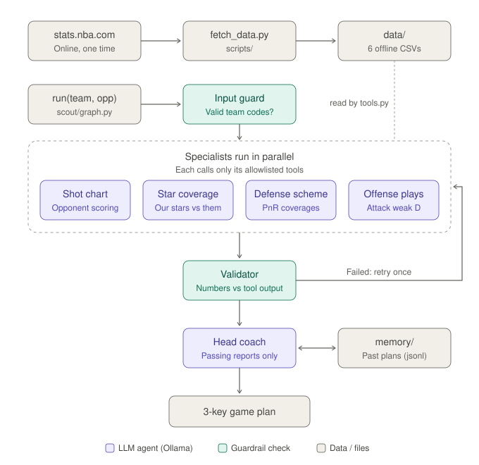

# basketball-scout-coordinator
Agent swarm that builds custom tactical game plans to stop specific NBA teams and key players.

A LangGraph graph of role-based agents, running on a local model through **Ollama**, reads
**offline January 2026 NBA data** and hands a validated 3-key game plan to the head coach.



```
input_guard -> [shot_chart_analyst | star_coverage | defensive_coordinator | offensive_architect]
            -> validator (retry failing agents once) -> head_coach -> END
```

## Setup

1. Install [Ollama](https://ollama.com) and pull a model that supports tool calling (default `qwen3`):
   ```bash
   ollama pull qwen3
   ```
2. Create the virtual environment and install dependencies:
   ```bash
   python3 -m venv .venv
   .venv/bin/pip install langgraph langchain-ollama nba_api pandas tabulate nbformat nbconvert ipykernel reportlab
   ```
3. Download the data once into `data/` (about 5 minutes; re-running skips files that already exist):
   ```bash
   .venv/bin/python scripts/fetch_data.py
   ```

## Run

Make sure Ollama is running: open the Ollama app or run `ollama serve`. `ollama list` should show `qwen3`.

From the project folder, pass your team and the opponent as 3-letter codes:
```bash
.venv/bin/python -c "from scout.graph import run; s = run('OKC', 'DEN'); print(s['final_plan'])"
```

To make sure a specific opponent player is included in the scouting:
```bash
.venv/bin/python -c "from scout.graph import run; s = run('BOS', 'MIL', focus_player='Giannis Antetokounmpo'); print(s['final_plan'])"
```

A run takes about 1-2 minutes. The returned state also has `trace` (every tool call), `reports`
(each specialist's report), `problems` (validation results) and `plan_problems`.

### Using a different Ollama model
Set `SCOUT_MODEL` to any model you have pulled that supports tool calling:
```bash
ollama pull llama3.1
SCOUT_MODEL=llama3.1 .venv/bin/python -c "from scout.graph import run; print(run('OKC','DEN')['final_plan'])"
```
Smaller models such as `llama3.2` (3B) run but call tools less reliably, so more reports fail validation.

### Step-by-step demo
```bash
.venv/bin/jupyter notebook notebooks/progress_demo.ipynb
```
The notebook shows the data checks, a tool demo, the guardrails rejecting a made-up report,
the graph, a full run with the tool-call trace, and the memory archive.

### Troubleshooting
- **Connection refused**: Ollama isn't running. Start the app or run `ollama serve`.
- **`data/... missing`**: run `scripts/fetch_data.py` first.
- **Unknown team code**: use NBA abbreviations such as `OKC`, `DEN`, `BOS`, `LAL`, `GSW`.

## Experiments

Every design choice is a field of `RunConfig` in `scout/graph.py`, so a variant is just a config:
```python
from scout.graph import RunConfig, run
state = run("OKC", "DEN", config=RunConfig(mode="single_agent", use_memory=False))
```

`experiments/run_experiments.py` runs each variant on the same matchups and writes
`experiments/results/<experiment>_runs.csv` (one row per run) and `<experiment>_summary.md` (averages per variant).
Each run takes about 1 minute, so `all` with 3 matchups takes roughly 1-1.5 hours.
```bash
.venv/bin/python experiments/run_experiments.py --experiment all --matchups 3
.venv/bin/python experiments/run_experiments.py --experiment prompting --matchups 5
```

| Experiment | Variants compared |
|---|---|
| `prompting` | full prompts, no grounding rules, no report format, no zone labels in tool output |
| `orchestration` | parallel swarm, sequential swarm, single agent with all tools, no validator, validator without retries |
| `memory` | with vs. without the plan archive; each matchup runs twice to measure plan consistency |
| `tools` | all tools, without `rotation_patterns`, without `player_shot_profile` |
| `safeguards` | baseline, prompt injection in tool output, injection without grounding rules, no tool allowlist |
| `models` | `qwen3` 8B vs. `llama3.2` 3B |

Metrics per run include: share of reports passing validation (first try and final), ungrounded
numbers, retries, tool calls and distinct tools used, `found: false` results, off-role tool calls,
reports that list data gaps, whether the final plan is valid, whether an injected instruction was
followed, plan similarity between repeated runs, and run time.

Deterministic guardrail tests (no LLM, a few seconds), including one known blind spot:
```bash
.venv/bin/python experiments/safeguard_tests.py
```

What the metrics can't measure: whether a correct number is used with the right meaning (e.g. a
team stat credited to a player). Check that by reading the `final_plan` column of the run CSVs.

## How it works
- **Agents**: Shot-Chart Analyst, Star Coverage Agent, Defensive Scheme Coordinator and Offensive
  Playbook Architect run in parallel. Each has a role prompt and its own tool allowlist. The Head
  Coach sees only the reports that pass validation.
- **Tools**: 8 deterministic pandas functions over the offline CSVs. They return `found: false`
  instead of guessing when data is missing.
- **Guardrails**: team codes are checked up front. Every number in a report must appear in that
  agent's tool output. Claims of more minutes than a game can last, or percentages above 100%, are
  rejected. Impossible data rows are dropped when the data loads.
- **Memory**: short-term memory is the shared LangGraph state. Long-term memory is the CSV
  dataset plus `memory/game_plans.jsonl`, an archive of validated plans that is shown to the Head
  Coach the next time the same matchup is scouted.

## Layout
- `scout/data.py`: CSV loading plus bounds checks (minutes no longer than the game, FG% between 0 and 1)
- `scout/tools.py`: analysis tools
- `scout/prompts.py`: role prompts, shared grounding rules, head-coach template
- `scout/guardrails.py`: input check, numeric grounding check, bounds check
- `scout/graph.py`: LangGraph orchestration (parallel fan-out, validator, retry loop)
- `scout/memory.py`: archive of past plans
- `experiments/run_experiments.py`: experiment runner and metrics
- `experiments/safeguard_tests.py`: deterministic guardrail tests
- `scripts/fetch_data.py`: one-time data download from stats.nba.com
- `scripts/build_notebook.py`, `scripts/build_pdf.py`: regenerate the demo notebook and the submission PDF
